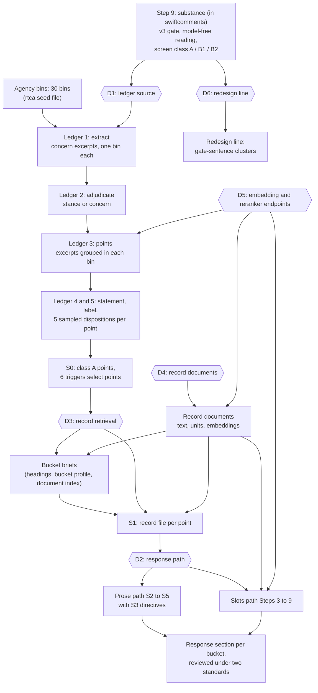

# The agency side: options for one pipeline

Status: options for discussion, 2026-10-20. The operator makes the decisions.

This document uses ASD-STE100 Simplified Technical English.

## 1. Purpose

swiftcomments stops at step 9 (substance). rtca started the agency side. eis-analysis continued it.
The two became two pipelines. swiftcomments must carry them as one pipeline.

This document gives the options for each decision. The diagram in section 3 shows where each
decision applies.

## 2. Sources

- rtca at the tag `reproduction-source`.
- eis-analysis at `f2598ec`. This commit is the same as GitHub `main`.
- The gitignored outputs of eis-analysis, copied into the workbench: `tmp/`, `respondkit/`,
  `deis/`, `deis2/`, `data/`.

## 3. The pipeline and the decisions

The boxes with a "D" number are decisions. Section 5 gives the options for each decision.

## 4. What exists

### 4.1 In rtca

| Item | Location | Function |
|---|---|---|
| Agency bins | `db/migrations_pending/agency_bins.sql`, `agency_bins_disjoint_ids.sql` | 30 bins in 7 families. The bins come from the Forest Service 2008 code families, with additions for the 2026 rescission. |
| Concern ledger | `scripts/substance/concern_ledger.py` | The model reads each gate-open comment. It writes concern excerpts with a bin, a move, a target, a forum and the citations. Later tasks group the excerpts and sample dispositions. |
| Point class | view `v_concern_point_class` | A point is class A when one carrier is class A. Only class A points go to the response. |
| Bucket profile | `scripts/substance/bucket_profile.py` | It records what each bucket argues, by words and by meaning. |
| Response headings | `docs/design/agency-theme-standard.md` | 36 headings, T-1 to T-36, from the Rescission DEIS Volume I. Each bucket has a heading. The operator froze this set on 2026-09-28. |
| Record side | `scripts/docindex/` | It divides the agency documents into sections and chunks, with embeddings. |

The swiftcomments plan (`reproduction-repo.md` §1) excludes these items by name.

### 4.2 In eis-analysis

| Item | Location | Function |
|---|---|---|
| Ledger, moved from rtca on 2026-09-29 | `src/ledger/`, `scripts/ledger/` | Steps 1 and 2 are the rtca steps. The extract prompt is v5 and writes no label. Step 3 makes points from the excerpt meaning, with no labels and no model judge. |
| S0 and S1 | `src/respondkit/s0.py`, `s1.py` | S0 selects points. S1 makes the record file for each selected point from the bucket brief. |
| Bucket briefs | `.claude/skills/bucket-brief/scripts/brief.py all` | A model writes queries from the headings and the bucket profile. The script runs the queries on the record documents. 30 briefs exist. |
| Prose path | `src/respondkit/s2.py` to `s5.py` | Record-supported code, directive scenarios, draft, collapse, review. Runs: 2026-09-11 to 09-30. |
| Slots path | `src/respondkit/s05.py`, `s1p.py`, `s2s.py`, `s6.py` to `s9.py` | Each claim is divided into parts. Each part gets verbatim record spans. The code is derived by code, not by the model. Runs: 2026-10-01 to 10-03. |
| Record documents | `deis/`, `deis2/` | 15 documents as PDF and Markdown. 26,704 units from 14 of the documents. |
| Redesign line | `src/concerns/`, `scripts/model_free/gate_clusters.py` | Clusters of comment sentences in place of bins and points. Nothing in this line connects to respondkit. |

### 4.3 In swiftcomments

swiftcomments has the inputs of the ledger: `substance_scores` (gate, `scored_via`, instrument
v3), `substance_screen` (class A), and `comment_group` with its members.

swiftcomments does not have the agency bins, the ledger, embeddings, the record documents, the
bucket profile, the briefs or respondkit.

## 5. The options

### D1: the source of the ledger

| Option | What it is | Result |
|---|---|---|
| D1-A | Port `concern_ledger.py` from rtca at the tag. | The extract writes labels. Points come from strands with a model judge. eis-analysis replaced this method because the labels split one claim into many points. |
| D1-B | Port `src/ledger/` from eis-analysis. | The extract writes no label. Points come from excerpt meaning, with no model judge. S0 and the briefs read this form of the points. |

### D2: the response path

| Option | What it is | Result |
|---|---|---|
| D2-A | The slots path, Steps 3 to 9. | Each answer has verbatim record spans. Code derives the disposition code. It has no directive scenarios. It ran on 12 batches. |
| D2-B | The prose path, S2 to S5, with S3. | The model selects the code. S3 applies the political directive scenarios. It ran on buckets in September. |
| D2-C | Both paths. | The two paths give two readings of each point, with and without directives. The cost is two sets of model calls. |

### D3: record retrieval for S1

| Option | What it is | Result |
|---|---|---|
| D3-A | The bucket briefs, then S1. | This option needs the response headings, the bucket profile and the document index. It is the S1 that the two response paths read now. |
| D3-B | Per-part retrieval only (slots Step 4). | This option needs the record units and their embeddings. It does not need the briefs or the bucket profile. It applies only with D2-A. |

### D4: the record documents

| Option | What it is | Result |
|---|---|---|
| D4-A | Get the documents from the docket. Convert them with the MinerU OCR that swiftcomments has now. | One conversion method for the whole repository. The units can be different from the `deis2/` units. |
| D4-B | Port `scripts/convert_deis_pdfs.py` and `scripts/record_units.py` from eis-analysis. | The units are the same as the units of the eis-analysis runs. |

Both options get the documents from their public source. The repository does not ship our
converted text.

### D5: the embedding and reranker endpoints

The points (D1-B), the briefs and the slots path need embeddings (qwen3-embedding-8b). The slots
path also needs a reranker (qwen3-reranker-8b).

| Option | What it is | Result |
|---|---|---|
| D5-A | Each endpoint gets its own variable in `.env`. | The operator names each server. |
| D5-B | One server, `LLM_BASE_URL`, gives all three. | This is possible only if the operator's server gives embeddings and reranking. |

The repository does not name an endpoint. The operator names it.

### D6: the redesign line

| Option | What it is | Result |
|---|---|---|
| D6-A | Leave it out. | The pipeline is the ledger and respondkit only. |
| D6-B | Port the gate-sentence clusters as a report. | The console shows the clusters beside the bins. No response step reads them. |
