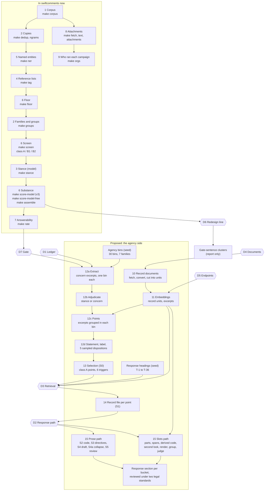

# The agency side: the to-be pipeline and its options

Status: proposal for discussion, 2026-10-20. The operator makes each decision. No code in this
document exists in swiftcomments yet.

This document uses ASD-STE100 Simplified Technical English.

## 1. Purpose

swiftcomments does the nine steps of rtca. Step 9 (substance) tells which comments the agency
must answer. The agency side continues from that point. It groups the substantive comments into
concerns and writes the response that the Final EIS can print for each concern.

rtca started the agency side. eis-analysis continued it after it split from rtca. Thus the work is
now in two pipelines. This document shows one pipeline in swiftcomments that does all of the work.
It also gives the options for each decision that the operator must make.

## 2. Sources

- rtca at the tag `reproduction-source`.
- eis-analysis at commit `f2598ec`. This commit is the same as GitHub `main`.
- The gitignored outputs of eis-analysis, copied into the workbench: `tmp/`, `respondkit/`,
  `deis/`, `deis2/`, `data/`.
- The swiftcomments plan, `reproduction-repo.md`. Its §1 excludes the agency side by name: "the
  record side", "the concern ledger", "EA issues" and "bucket profiles". This proposal is a §10
  revision of the plan.

## 3. The to-be pipeline

### 3.1 Diagram

The steps 1 to 9 are in swiftcomments now. The steps 10 to 15 are the proposal. A hexagon is a
decision. Section 5 gives the options for each decision.

### 3.2 The proposed steps

The make targets in this table are proposals. They do not exist.

| Step | Proposed target | Input | Output | Model |
|---|---|---|---|---|
| 10 Record documents | `make record` | the agency documents of the docket | the text of each document, cut into units | none (OCR for D4-A) |
| 11 Embeddings | `make embed` | record units, concern excerpts | one vector for each distinct text | embedding model |
| 12a Extract | `make ledger TASK=extract` | each gate-open comment (D7) | concern excerpts with a bin, a move, a target, a forum and citations | yes, one call for each comment |
| 12b Adjudicate | `make ledger TASK=adjudicate` | each distinct excerpt | stance or concern | yes, one call for each excerpt |
| 12c Points | `make ledger TASK=points` | the concern excerpts in each bin | points: groups of excerpts that make one claim | none (D1-B) or a judge (D1-A) |
| 12d Statements and samples | `make ledger TASK=statements`, `TASK=samples` | each point | a statement, a label, 5 sampled dispositions | yes |
| 13 Selection | `make select` | the points, the screen classes | the class A points; the triggers that select them for a record check | none |
| 14 Record files | `make record-files` | the selected points, the record (D3) | a record file for each point and a record for each bucket | none, or one query call for each bucket (D3-A) |
| 15 Response | `make respond BUCKET=...` | the record files | the response section for each bucket, with its review | yes |

The console gets one page for each new step. The page shows the rows that the step wrote, as the
results pages do now.

## 4. What exists now

### 4.1 In rtca

| Item | Location | Function |
|---|---|---|
| Agency bins | `db/migrations_pending/agency_bins.sql`, `agency_bins_disjoint_ids.sql` | 30 bins in 7 families: process, rule, eis, resources, recreation, lands, socioeconomic. The bins come from the Forest Service 2008 code families, with additions for the 2026 rescission. |
| Concern ledger | `scripts/substance/concern_ledger.py` | The model reads each gate-open comment and writes its concern excerpts. Later tasks adjudicate, group and sample. |
| Point class | view `v_concern_point_class` | A point is class A when one or more carriers are class A. Only class A points go to the response. |
| Bucket profile | `scripts/substance/bucket_profile.py` | It records what each bucket argues, by words and by meaning. |
| Response headings | `docs/design/agency-theme-standard.md` | 36 headings, T-1 to T-36, from the table of contents of the Rescission DEIS Volume I. Each bucket has one or more headings. The operator froze the set on 2026-09-28. |
| Record side | `scripts/docindex/` | It divides the agency documents into sections and chunks, with embeddings. It also writes the heading brief. |
| Design | `docs/design/agency-response-model.md` | The model of the agency response. Status: "BUILT AND RUN". |

### 4.2 In eis-analysis

| Item | Location | Function |
|---|---|---|
| Ledger | `src/ledger/`, `scripts/ledger/` | The ledger moved from rtca on 2026-09-29. Steps 1 and 2 are the rtca steps; the extract prompt is v5 and writes no label. Step 3 makes points from the excerpt meaning, with no labels and no model judge. |
| S0, S1 | `src/respondkit/s0.py`, `s1.py` | S0 selects the points. S1 makes the record file for each selected point from the bucket brief. |
| Bucket briefs | `.claude/skills/bucket-brief/scripts/brief.py all` | A model writes queries from the headings and the bucket profile. The script runs the queries on the record documents. 30 briefs exist in `docs/indexing/briefs/`. |
| Prose path | `src/respondkit/s2.py` to `s5.py` | The code that the record supports, the directive scenarios, the draft, the collapse and the review. Runs: 2026-09-11 to 2026-09-30. |
| Slots path | `src/respondkit/s05.py`, `s1p.py`, `s2s.py`, `s6.py` to `s9.py` | Each claim is divided into parts. Each part gets verbatim record spans. Code derives the disposition code. Runs: 12 batches, 2026-10-01 to 2026-10-03. |
| Record documents | `deis/`, `deis2/` | 15 documents as PDF and Markdown. 26,704 units from 14 of the documents. |
| Redesign line | `src/concerns/`, `scripts/model_free/gate_clusters.py` | Clusters of comment sentences in place of bins and points. This line does not connect to respondkit. |

### 4.3 In swiftcomments

swiftcomments has the inputs of the ledger:

- `substance_scores`: the gate, `scored_via` and the instrument (v3);
- the model-free reading;
- `substance_screen`: the screen class of each comment;
- `comment_group` and its members, for the carrier counts.

swiftcomments does not have the agency bins, the ledger, embeddings, the record documents, the
bucket profile, the briefs or the response steps.

## 5. The decisions and their options

### D1: the source of the ledger (step 12)

The ledger finds the concerns in the gate-open comments. Two forms of the ledger exist.

**D1-A: port `concern_ledger.py` from rtca at the tag.**

- The extract writes a label for each excerpt.
- Points come from strands (excerpts with the same label). A model judge merges the strands.
- eis-analysis stopped this method on 2026-09-29. The reason: 80,482 statements had 31,160
  distinct labels. One claim thus became many strands, and the judge merged them differently on
  each run.
- The S0, the briefs and the response paths of eis-analysis do not read this form of the points.

**D1-B: port `src/ledger/` from eis-analysis.**

- The extract writes no label.
- Points come from the excerpt meaning: complete linkage on the embeddings, cut at cosine distance
  0.27, then joins on shared evidence markers. No model judge.
- A point keeps its id when new comments arrive.
- This is the form that S0, the briefs and the two response paths read.
- It needs embeddings (D5).

### D2: the response path (step 15)

**D2-A: the slots path.**

- The model divides each claim into parts.
- Each part gets verbatim record spans. Code checks each span against the record text.
- Code derives the disposition code from the slots. The model does not select it.
- Before a dismissal, a second look searches for record support for the commenters.
- The model writes the prose from the slots only. Code groups the points. Two judges review each
  part.
- It has no directive scenarios.
- It ran on 12 batches. Example: cie2, 41 selected points, 28 of 40 passed, cost $1.27.

**D2-B: the prose path.**

- The model selects the code that the record supports (S2).
- S3 applies the directive scenarios: the political rules that can change the published code.
- The model writes the draft (S4) and collapses it to the published shape (S4a).
- Counsel reviews the section under the deferential and the hard-look standards (S5).
- It ran on buckets from 2026-09-11 to 2026-09-30.

**D2-C: both paths.**

- Each point gets two readings: the slots reading, and the prose reading with directives.
- The difference shows the effect of the directives.
- The cost is two sets of model calls.

### D3: the record retrieval for the record files (step 14)

**D3-A: the bucket briefs, then S1.**

- A model writes queries from the response headings and the bucket profile.
- The queries run on the record by words and by embeddings.
- S1 makes the record file for each point from the brief.
- It needs the response headings, the bucket profile and the document index.
- Cost: about $0.30 for 29 buckets (eis-analysis, 2026-09-30).
- Both response paths read this record file now.

**D3-B: per-part retrieval only.**

- Slots Step 4 searches the record units for each part of a claim.
- It needs the record units and their embeddings. It does not need the briefs or the bucket
  profile.
- It applies only with D2-A.

### D4: the record documents (step 10)

Both options get the documents from their public source. The repository does not ship our
converted text.

**D4-A: convert with the MinerU OCR of swiftcomments.**

- One conversion method for the whole repository.
- The units can be different from the `deis2/` units of the eis-analysis runs.

**D4-B: port `scripts/convert_deis_pdfs.py` and `scripts/record_units.py` from eis-analysis.**

- The units are the same as the units of the eis-analysis runs.
- The repository has two conversion methods: one for attachments, one for the record.

### D5: the embedding and reranker endpoints (step 11)

The points (D1-B), the briefs (D3-A) and the slots path (D2-A) need embeddings
(qwen3-embedding-8b). The slots path also needs a reranker (qwen3-reranker-8b). The repository
does not name an endpoint. The operator names it.

**D5-A: one variable in `.env` for each endpoint.** The operator names each server.

**D5-B: one server, `LLM_BASE_URL`, for all three.** This is possible only if the server gives
embeddings and reranking.

### D6: the redesign line

**D6-A: leave it out.** The pipeline is the ledger and the response steps only.

**D6-B: port the gate-sentence clusters as a report.** The console shows the clusters beside the
bins. No response step reads them.

### D7: the gate that feeds the ledger (step 12a)

rtca and eis-analysis extract from the comments that the v3 model gate opens, scored on their own
(`scored_via` is not `inherited`). swiftcomments has two readings of the gate.

**D7-A: the v3 model gate.** The same population as rtca and eis-analysis.

**D7-B: the model-free gate.** A gate with no model call. It opens a different population.

**D7-C: the union of the two gates.** No comment that one reading opens is left out. The ledger
reads more comments.

The point class (step 13) stays the screen class: a point is class A when one or more carriers are
class A. B1 comments that the model-free reading opens can carry a point. Only class A points go
to the response.

## 6. Figures from earlier runs

These figures are from rtca and eis-analysis. They are not figures of swiftcomments.

| Run | Figure | Source |
|---|---|---|
| Extract, rtca, 2026-09-06 | 13,080 comments, 67,837 statements, 36.5 minutes, about $3.34 | rtca `agency-response-model.md` §5b |
| Points, eis-analysis, 2026-09-29 | 3,788 points in 31 buckets | eis-analysis `excerpt-points-ledger-s0-s1.md` |
| S0, eis-analysis, 2026-10-01 | 2,816 class A points in 29 buckets, 1,380 selected | eis-analysis `V3_DESIGN.md` |
| Bucket briefs | about $0.008 for each bucket | eis-analysis `bucket-brief-automation.md` |
| Slots path, cie2 | 41 selected points, 28 of 40 passed, $1.27 | eis-analysis `V3_DESIGN.md` |
