# The method, end to end

This page explains the whole analysis: what question each stage answers, how
each stage answers it, and what the reference run found, with figures. The
README says how to run it; this page says what it does and why. Each section
links to the page that holds the full detail, and every figure's numbers come
from a page of `docs/` or a reviewed table of `seeds/`.

## The question

In 2026 the Forest Service proposed to rescind the Roadless Area Conservation
Rule. The public filed 390,064 comments on the proposal (regulations.gov
docket FS-2025-0001). The agency must consider the comments that raise
substantive issues and should address them in writing (7 CFR 1b.7(f)(1)). Two
defined terms carry the duty. An *issue* is a logical cause-effect
relationship between the action and its impacts. *Substantive* means
information that meaningfully informs one of four things: the consideration
of impacts, the significance determination, the alternatives, or compliance
with law. `background.md` gives the law in full.

The pipeline takes its shape from that regulation:

- The **gate** of the substance reading follows 1b.11(53): a comment is
  substantive when it states a deficiency (GAP), applies evidence (EVID),
  offers an alternative (ALT), or raises the law (LAW).
- **Answerability** follows the no-action rationales of 1b.7(f)(2)(vi): which
  of the agency's standard dismissals a comment defeats.
- The **clusters** follow 1b.7(f)(1)(ii): comments on the same issue may be
  grouped and answered once.
- The **record search** asks the question behind "addressed in the analysis":
  what does the record already do with each point?

## The scale, and how this work was done before

The fullest public account of the manual method is the Forest Service's own,
for the 2001 Roadless Rule: 1,155,000 pieces of input, read by comment coders
who highlighted substantive passages, copied them into a database, and
organized them into about 2,450 public concern statements. About 97% of the
responses were copies of about 310 form letters. The 2008 Idaho roadless
rulemaking used the same method on 139,120 comments. A 2021 federal review
found most agencies still doing this work in Excel, Word and SharePoint.
`background.md` cites each account and maps the eleven steps of the manual
process onto the steps of this repository, one for one.

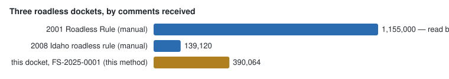

This docket is far past manual scale, and automation changes the work in one
specific way: a procedure gives the same result on every run, and it also
makes the same error on every comment of one kind, where a person's errors
scatter. The method therefore measures its own instruments at every stage
(see "How the method is measured" below), and keeps every choice inspectable.

## The shape of the pipeline

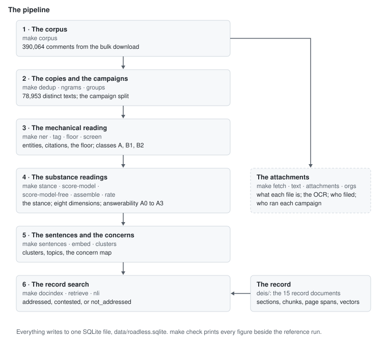

The method narrows as it goes. Most comments are copies of a campaign letter.
Most distinct texts state a position without material to score. The
substantive comments carry the sentences that the clusters and the record
search read. The first two figures below are counts of the docket; the later
figures depend on the readings, and your run's will differ at the margin.

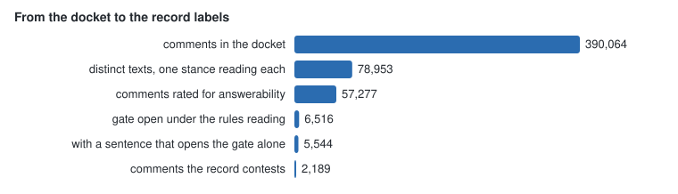

## 1 · The corpus

`make corpus` loads the bulk download regulations.gov publishes for the
docket: one row per comment, one row per attachment file, into one SQLite
file. The comment text is the export's rendering of what the API serves; the
two match, once rendered, for 390,048 of the 390,062 comments with text
(README, "The text the API serves and the text you have"). Every later span —
a rule hit, a sentence, an evidence quote — is a character range into this
stored text, so every finding traces back to the comment.

## 2 · The copies and the campaigns

Most of the docket is the same letter filed many times. Finding copies is an
established problem (`background.md`, section 5, surveys the techniques:
shingling, MinHash, SimHash). Step 2 applies four layers, each folding what
the layer above did not:

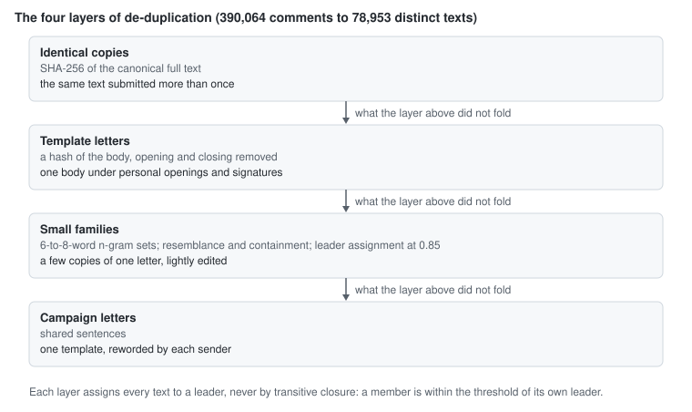

Two choices matter and are made deliberately. First, groups form by leader
assignment, never by transitive closure: closure chains texts that are each
similar to the next but not to each other, and a leader keeps every member
within the threshold of its own leader. Second, the campaign/own-text split
is kept per group, so a campaign letter with a sender's own additions is not
silently folded into its template.

The 390,064 comments hold 78,953 distinct texts. The stance (`make stance`)
is then read once per text and copied to the members — SUPPORT, OPPOSE or
NEUTRAL, one model call per group instead of one per comment. The one
measured model-step figure so far: 78,953 calls, 107.0 M tokens in, 17.6 M
out (README, "The model steps").

## 3 · The mechanical reading

Four steps read every comment with code and dictionaries only. `make ner`
reads the named entities. `make tag` finds what each comment names: legal
authorities, cited references, forests, roadless areas, species, ZIP codes —
each by a committed seed list, so a match is checkable. `make floor` decides
which comments have substance to read at all. `make screen` sorts the
comments into classes: class A is read directly by the substance readings;
class B1 (refers to the action but cites nothing) the rules can read at no
cost. No stage here calls a model; every decision is a rule a reader can step
through, and the law-dependent levels downstream depend on these tables.

## 4 · The substance readings

This is the heart of the method: deciding, comment by comment, what is
substantive under the regulation's definitions. The scheme grades a text on
eight dimensions, each from level 0 to 3:

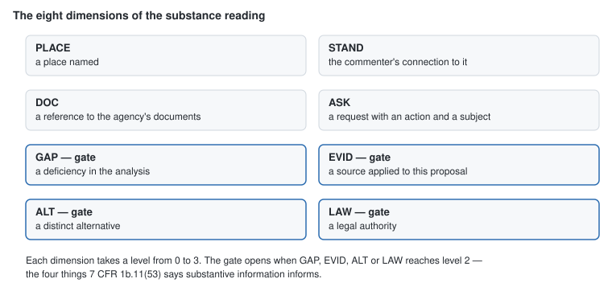

The gate follows the regulation, not a score: GAP and EVID are issues and new
information, ALT is an alternative, LAW is compliance, the four things
1b.11(53) names. The sum of the eight levels is the strength band (minimal,
marginal, developed, strong), kept for description, never for the gate.

**The reading exists twice, by design.** `make score-model` sends every class
A comment to a language model under the v3 instrument
(`instruments/substantive-scoring-v3.md`), which returns the eight levels
with evidence spans. `make score-model-free` scores the same comments by
rules alone: 26 word lists, a spaCy parse, and a fixed rule order, every hit
stored with its matched words and offsets (`methods-scoring.md`). A reader
without a model server still runs the whole method; a reader with one runs
both and sets them side by side (`make score-model-compare`), with every
comparison stamped with its git commit, model and rule set.

Three details of the rules carry most of their quality, and
`methods-scoring.md` derives each formally:

- **Quoted text is removed** before GAP, ASK, ALT and STAND read: a commenter
  who pastes the DEIS does not get credit for the DEIS's words.
- **The generality test**: GAP, EVID and DOC score 0 unless the text has an
  anchor — the document, a place, this action, a figure. A general complaint
  about the environment opens no gate.
- **Hybrid mode**: the rules read the whole comment but hold GAP to what one
  sentence reaches, because whole-comment reading pairs an effect verb in one
  sentence with a place name in another ("I live in Tennessee" + "this could
  increase road construction" is not a stated deficiency).

**Where the two readings agree, and where they do not.** On the 7,588
comments both read directly, agreement splits cleanly by prong — the four
0-or-1 columns, one per limb of 1b.11(53), that both readings carry:

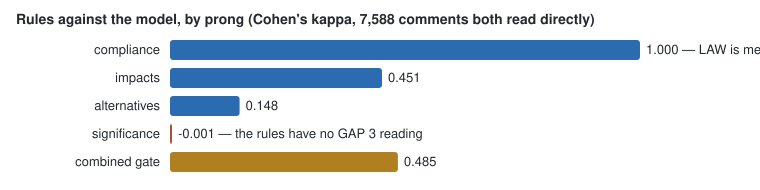

Compliance agrees perfectly because LAW is mechanical on both sides: the same
citation tables decide it. Significance is the rules' largest miss — the
rules reach GAP 3 on 4 comments where the model reaches it on 510 — so the
rules have no working significance reading, and the method says so rather
than averaging it away. One combined kappa would hide all of this.

The gate set of the model reading is 4,846 comments, and the prongs say how
each one qualifies:

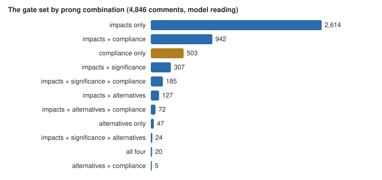

The 503 compliance-only comments carry their own caveat, found by a reading
test (`seeds/prong_reading.jsonl`): readers judged the assigned prong a right
description for 49 of 50 impacts-only comments but only 6 of 50
compliance-only comments. Those comments cite a law but ask the agency to
weigh impacts — the citation is not the ask — so the compliance-only count is
never reported as "answered by a legal reading".

**Answerability** then asks what the open gate is worth: which of the
agency's no-action replies (1b.7(f)(2)(vi)) the comment defeats.

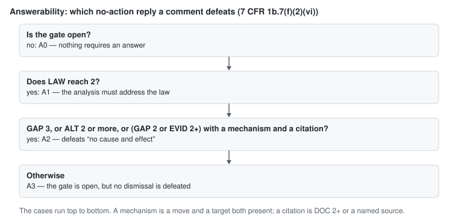

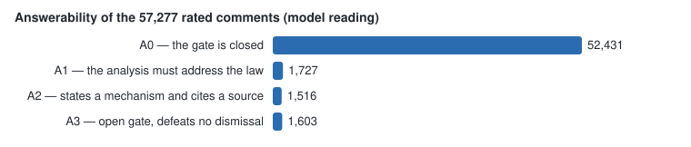

A1 defeats "addressed in the analysis" and "certified not substantive",
because the analysis must address the law. A2 defeats "no cause and effect",
because the comment states a mechanism and cites a source. A3 opens the gate
and defeats neither. Most of the docket is A0: the gate is closed, and
nothing requires an individual answer.

## 5 · The sentences and the concerns

The agency may group comments on the same issue and answer the issue once.
This stage finds the issues. It runs on the 6,516 comments whose rules gate
is open (4,647 class A, 1,869 class B1) and clusters their sentences by
meaning — with no generative model anywhere in it. The same input gives the
same result.

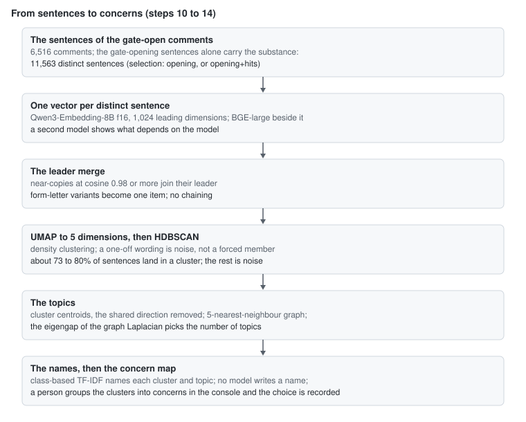

Each design choice in that flow was measured before it was adopted
(`methods-clustering.md`):

- **Only the gate-opening sentences are clustered** (11,563 distinct
  sentences). Clustering every sentence of the gate-open comments drowns the
  substance in register lines: the densest "clusters" are the subject line
  (1,539 copies) and thank-you lines, and coverage of comments falls.
- **Two embedding models run side by side** (Qwen3-Embedding-8B and
  BGE-large), so a reader can see what depends on the model. They find the
  same main subjects (adjusted Rand 0.41–0.64) and draw the edges
  differently. The f16 local model reproduces the API's vectors; the 4-bit
  model changes 1 in 12 nearest neighbours and is not used.
- **The leader merge** joins form-letter near-copies (cosine ≥ 0.98) before
  clustering, because they otherwise dominate the density.
- **UMAP, not PCA, before HDBSCAN**: PCA clusters 32–36% of the sentences,
  UMAP 73%, because density clustering needs the neighbours kept.
- **HDBSCAN leaves noise**: a one-off wording is noise, not a forced member
  of the nearest cluster. Forcing a cluster count chains unrelated subjects.
- **Topics come from the data**: cluster centroids with the shared direction
  removed (almost every comment opposes the rescission in the rule's own
  words, and that shared direction makes every pair of clusters look alike),
  then the eigengap of the neighbour graph picks the number of topics.
- **Names are extractive** (class-based TF-IDF over each cluster's words plus
  its two most central sentences); no model writes a name.

No setting is chosen beforehand. Every run is a recorded **case** — settings,
git commit, measures — and cases are compared on their results. The key
recall measure is the gate-open comment with no substantive sentence in any
cluster, because that is a claim a reader can miss:

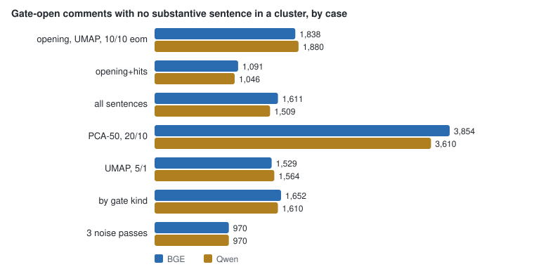

Stability is measured too: over five seeds at the reference settings the
cross-seed adjusted Rand is 0.645 (Qwen) and 0.757 (BGE); PaCMAP was tried in
place of UMAP, measured lower (0.497 and 0.632) with a collapse into one
catch-all cluster, and refuted. The final grouping — which clusters are one
concern — is a human choice, made in the console's Topics page with the cases
in view, and recorded (`topics-guide.md`).

### What the chosen case found

The recorded choice on the Qwen vectors (2026-10-26: the `opening` selection,
plain view, merge 0.95, UMAP to 5, HDBSCAN 10/10 eom, one noise pass, seed 0,
vectors centred) groups the 11,563 gate-opening sentences into 9,530 merged
items, puts 8,817 of them — 13,485 of the 14,356 occurrences — into 237
clusters, with no catch-all (largest 318), and draws 11 topics over them.
5,285 of the 6,516 gate-open comments have a substantive sentence in a
cluster. The BGE choice beside it finds 352 clusters in 9 topics; with the
merge, the two choices agree at adjusted Rand 0.56 (the recorded choice
note).

The topics, with their extractive names exactly as the case stored them — no
model wrote a word of this:

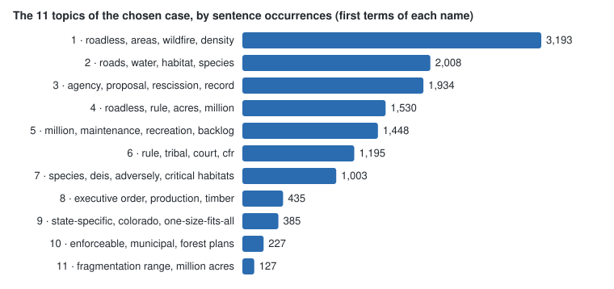

| Topic | Clusters | Distinct sentences | Occurrences | The name's terms, verbatim |
|---|---|---|---|---|
| 1 | 46 | 1,898 | 3,193 | roadless, areas, wildfire, density, roads, roadless areas, ignition, forest |
| 2 | 37 | 1,286 | 2,008 | roads, roadless, water, areas, road, habitat, species, roadless areas |
| 3 | 27 | 1,072 | 1,934 | agency, proposal, rescission, record, wildfire, agency record, data, rule |
| 4 | 29 | 1,254 | 1,530 | roadless, rule, acres, forest, million, conservation, area conservation, area |
| 5 | 29 | 959 | 1,448 | million, maintenance, recreation, analysis, billion, backlog, road, agency |
| 6 | 21 | 679 | 1,195 | rule, tribal, court, cfr, district, agency, cfr subpart, exercising |
| 7 | 20 | 841 | 1,003 | species, deis, forest, agency, adversely, rescission, critical habitats, analysis |
| 8 | 10 | 311 | 435 | forest, executive, executive order, production, order, timber, unleashing, order unleashing |
| 9 | 9 | 269 | 385 | roadless, rule, state-specific, proposal, colorado, local, agency, one-size-fits-all |
| 10 | 5 | 155 | 227 | enforceable, agency, forest, provision, municipal, plan provisions, water, forest plans |
| 11 | 4 | 93 | 127 | fragmentation range, range million, agency apply, cited fragmentation, acres, million, apply cited, million acres |

The subjects are read off the terms: wildfire and ignition density near roads;
water, habitat and species; the agency's record against its own rationale;
the acres the rule protects; the road-maintenance backlog and the economics;
Tribal consultation, the courts and the CFR; species and critical habitat in
the DEIS; timber production under the executive orders; state-specific rules;
municipal water under forest plans; the fragmentation figures.

Four clusters show what a cluster is. Each is one claim; the sentences shown
are the two nearest its centre, verbatim from the comments.

**One claim in 318 wordings** — cluster 1 (topic 1): 318 distinct sentences,
378 occurrences, all applying the same ignition-density research:

> "Research suggests that most wildfire ignitions occur near roads (Aplet,
> G.H., Hartger, P. & Dietz, M.S. Three-decade record of contiguous-U.S.
> national forest wildfires indicates increased density of ignitions near
> roads. fire ecol 22, 8 (2026)); allowing for additional road construction
> in roadless areas increases wildfire risk."
>
> "Research in Fire Ecology found that fires are about four times more likely
> to start near a road than in a roadless area, and the agency's own analysis
> acknowledges that human-caused wildfires could become more frequent if
> roads open this terrain to vehicles and campfires."

**One quoted line, filed 272 times** — cluster 226 (topic 1): 11 distinct
wordings, 272 occurrences, a campaign quoting the DEIS against the proposal:

> "The DEIS states — 'Building a road into a forest at high risk from
> uncharacteristic wildfire effects could increase the incidence of
> human-caused fires.'"

**One study, cited a hundred ways** — cluster 13 (topic 2): 100 distinct
sentences, 154 occurrences, the same drinking-water finding:

> "Olden et al. (PLOS Water, 2026) found roadless-rule-protected watersheds
> supply drinking water to an estimated 25 million Americans, with ~62,000 of
> the ~80,000 protected river miles relying on the roadless rule as their
> only federal protection."

**One concern in personal words** — cluster 7 (topic 2): 134 distinct
sentences, each a commenter's own place:

> "Roads and logging up to their edges would degrade the experience that
> defines the White Mountains."
>
> "Areas such as Silver Peak are still wild and remote, and I would be
> devastated to see that landscape fragmented by new roads."

That range is the capability: a verbatim campaign line, a citation repeated
in a hundred paraphrases, and hundreds of individually written sentences,
each gathered into one claim a reader answers once. The console's Topics page
opens any topic to its clusters and any cluster to its sentences and their
comments.

## 6 · The record search

A point is answerable when the record can answer it, so the last stage asks
what the record already does with each point.

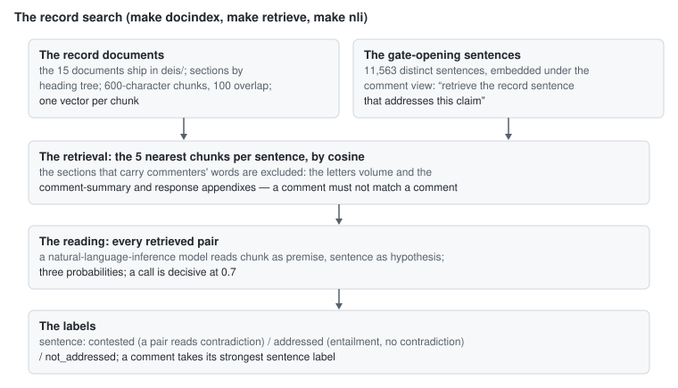

Two design points carry the stage. First, the **exclusion**: the sections of
the record that hold commenters' own words — the letters volume, the
comment-summary appendix, the response-to-comments appendix — are outside the
search, because a match there is the agency's paraphrase of a comment, not
the record addressing the point. The exclusion is not a detail: searched with
those sections in, 7,294 of 11,563 sentences (63.1%) take an excluded chunk
first. Second, the **embedding instruction**: the sentences are embedded
under the comment view ("retrieve the record sentence that addresses this
claim"), and a reviewed reading test showed the instruction earns its run —
the meant passage is retrieved first for 57 of 100 record-citing sentences
against 43 under plain vectors, and is in the top 5 for 82 against 71:

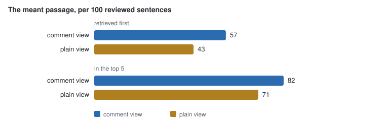

The same test found no cosine floor below which the retrieval stops finding
the meant passage, so every retrieved pair is read:

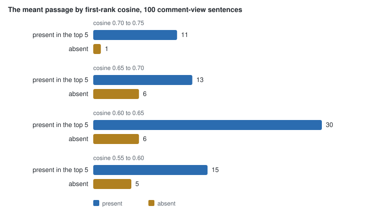

The reading's calls over all 57,815 pairs, and the labels they produce:

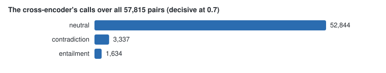

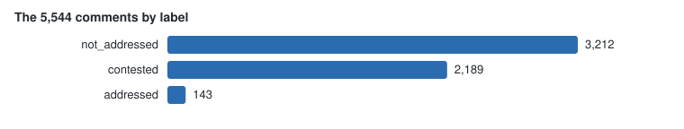

The instrument itself was then tested the same way as everything else, and it
failed in one specific place: readers confirm only 5 of 30 of the NLI model's
contradiction calls (kappa 0.157) — it calls contradiction where the passage
is on a nearby point without disputing the sentence. Its neutral calls hold.

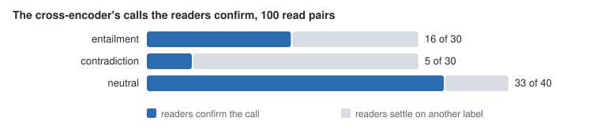

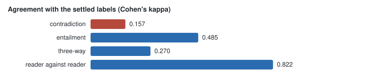

So the `contested` figure above is read with that result in view, and the
contradiction calls are not used as-is. The test, the cross-tab and the
reviewed table: `results.md` and `seeds/nli_reading.md`.

## The attachments

The comment texts stand on their own: no stage above reads an attachment. The
attachment stages are the rest of the docket, about 19 GB of files. `make
fetch` downloads every file, `make text` extracts the text, `make
attachments` decides what each file is, reads the scans that can hold a
letter by OCR, and reads who filed each letter; `make orgs` says who ran each
campaign, on four bases. These stages land in later commits; the README's
Status section says which targets are built at each commit.

## How the method is measured

Automation's bargain is stated above: a procedure is consistent, and it makes
the same error on every comment of one kind. So the method measures its
instruments instead of trusting them, with one pattern used everywhere a call
needs human-level judgment:

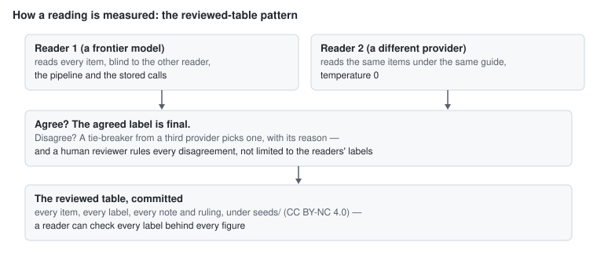

Five reviewed tables exist so far, committed under `seeds/` with their draw
procedures and verbatim reading guides: the labelled set (374 items, the
gate), the answerability reread (100 comments), the prong reading (100
comments), the retrieval reading (200 retrieval lists), and the NLI reading
(100 pairs). Agreement between the two blind readers on each:

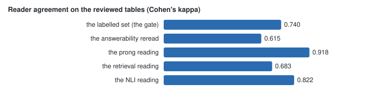

Every measured decision is in the ledger, `results.md`: the method proposed,
the test, the figures, the outcome. The refuted methods stay recorded beside
the adopted ones — PaCMAP as the reduction, component removal past the mean,
clustering by prong, the retrieval's cosine floor, and the NLI model's
contradiction calls — because a result that cannot be seen to have been
tested cannot be trusted either.

What the measures are not: agreement with another instrument, or between two
model readers, is consistency, not ground truth. A person-coded labelled set
remains future work, and `background.md` section 8 lists it first.

## Reproducing, sampling, checking

Nobody has to run everything to check something.

- Every queue step takes `LIMIT=N`: read N units, write them, stop. The
  console then shows the rows beside the code that made them.
- `make extract` and `make jump` save and load each step's result, so a
  reader runs the steps they care about and takes the reference result for
  the rest (`limit-and-jump.md`).
- `make check` prints every figure of the method beside the reference run's
  (`checks/figures.sql`); a deterministic figure that differs fails.
- `make console` is the browser of the file: every comment as the analysis
  read it, every score with its evidence spans, every comparison of the two
  readings, every clustering case.

Figures differ between runs where the text rendering, the OCR engine, or the
model varies; deterministic figures do not (README, "The reference figures,
and yours").
