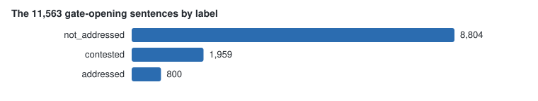

# The record retrieval: make retrieve, make nli

`make retrieve` finds, for every gate-opening sentence, the nearest passages of
the record documents that `make docindex` loaded. `make nli` then reads every
retrieved pair with a natural-language-inference model and labels every
sentence and comment. The labels say what the record already does with each
point: it says the same thing, it says the opposite, or its nearest passages
say neither.

## The retrieval

The query is the sentence's comment-view vector (`make embed VIEW=comment`).
The target is each record chunk's vector (`make docindex`). Both come from the
same embedding model, so their cosine compares them. For each distinct sentence
that opens the gate alone, the step stores the 5 nearest chunks in
`doc_retrieval`, nearest first.

Sections that carry commenters' words are not searched. Three bodies of text
are excluded: the agency-letters volume, the comment-summary appendix, and the
response-to-comments appendix. Each holds what commenters said, or the agency's
paraphrase of it. A match there does not mean the record addresses the point.
Run `make retrieve EXCLUDED=1` to measure the exclusion: it searches the
excluded sections too, prints how many sentences take an excluded chunk first,
and writes nothing.

## The NLI reading

For every retrieved pair, the cross-encoder reads the chunk as the premise
and the sentence as the hypothesis. It stores three probabilities in
`doc_nli`: entailment, neutral, contradiction. A probability of 0.7 or more
is decisive. No similarity floor gates the reading: a reviewed reading test
found no cosine below which the retrieval stops finding the meant passage
(`seeds/retrieval_reading.md`).

The model is `MoritzLaurer/DeBERTa-v3-large-mnli-fever-anli-ling-wanli`. It
runs on your machine. Install it with `uv sync --group nli`; the first run
downloads it from Hugging Face. The run resumes: a pair with a stored row is
not read again. If you rebuild the retrieval, the run removes the stored
readings of pairs the new retrieval does not hold.

## The labels

Each sentence gets one label in `doc_sentence_label`, with the pair that gave
it:

| Label | Meaning | Condition |
|---|---|---|
| `contested` | The record says something the sentence disputes | a pair reads contradiction |
| `addressed` | The record already says what the sentence says | a pair reads entailment, none reads contradiction |
| `not_addressed` | The nearest passages neither entail nor contradict | every pair read, none decisive |

Each comment gets the strongest label over its gate-opening sentences, in the
order contested, not_addressed, addressed (`doc_comment_label`).

## The figures of the run (2026-10-27)

The run reads 11,563 gate-opening sentences and stores the 5 nearest chunks
for each: 57,815 pairs. The cross-encoder reads every pair. Most pairs read
neutral. The decisive calls set the labels.


The labels that result:




A reading test of the cross-encoder's calls is in `seeds/nli_reading.md`, with
its figures in `docs/results.md`. Readers confirm most of its neutral calls
and few of its contradiction calls. Read the `contested` counts with that
result in view.

The exclusion figure: with the excluded sections searched, 7,294 of 11,563
sentences (63.1%) take an excluded chunk first. Without the exclusion, most
sentences match a commenter's own words, not the record.

## The commands

```
make retrieve DRY=1      count the sentences and chunks, write nothing
make retrieve            the 5 nearest chunks per sentence
make retrieve EXCLUDED=1 the excluded-sections figure, write nothing
uv sync --group nli     install the NLI model's dependencies, once
make nli LIMIT=10       a pilot: read 10 pairs, no labels yet
make nli                read every retrieved pair, then build the labels
make nli LABELS=1       rebuild the labels from stored rows, read nothing
```

`K=` changes the chunks kept per sentence, and `MODEL=` names the embedding
model when more than one fits.

## The tables

| Table | One row per |
|---|---|
| `doc_retrieval` | sentence and rank: the chunk and the cosine |
| `doc_nli` | read pair and NLI model: the three probabilities |
| `doc_sentence_label` | sentence: the label and the pair that gave it |
| `doc_comment_label` | comment: the strongest label and the sentence that gave it |
