# Topics: from the sentences to the concern map

This guide tells you how to make the concern map. The concern map is one clustering of
the substantive sentences. In a good concern map, each cluster is one claim that
commenters make. The next step of the method writes one concern statement for each
cluster.

The work has five stages. Do them in order.

| Stage | You do | Where | Result |
|---|---|---|---|
| 1. Sentences | Run `make sentences`. | terminal | The sentences of the gate-open comments. |
| 2. Vectors | Run `make embed VIEW=plain` for each model. | terminal | One vector for each sentence and model. |
| 3. Cases | Run `make case-set MODEL=<model>` for each model. | terminal | Nine clustering cases for each model. |
| 4. Best case of each model | Read the cases of one model and choose the best case. Do it again for the other model. | console | One choice for each model. |
| 5. Concern map | Compare the two choices and decide on one. | console | The concern map. |

The screenshots show our run of 2026-10-21 to 2026-10-23. Your figures can be different.

All the stages are experiments. You can do a stage again at any time. The section
[Do a stage again](#do-a-stage-again) tells you what each stage replaces.

## Before you start

1. Run `make score-model-free CLASSES=A,B1`.
2. Open `.env` and set the embedding server for the first model (stage 2 tells you how).
3. Start the console with `make console`.
4. In the console, open the page **Topics**.

## The Topics page

The top of the page shows one line for each stage. Each line has a state and the figure
from the file:

- **done**: the stage has its result.
- **next**: do this stage now. If the stage runs in the terminal, the line shows the
  command.
- **waiting**: an earlier stage is not done.

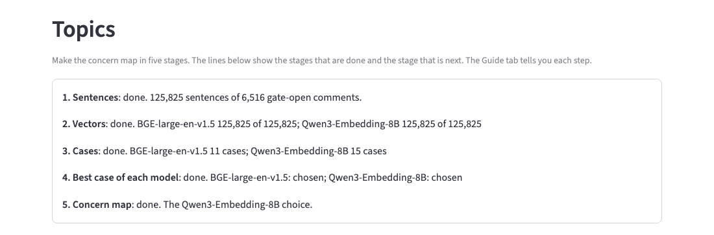

The page has five tabs:

| Tab | What it is for |
|---|---|
| Guide | This guide. |
| Stage 4: Best case of each model | Compare the cases of one model and choose one. |
| Stage 5: Concern map | Compare the two choices and decide on the concern map. |
| What the stages found | The result of each stage, as figures and charts. |
| Read a case | Read one case: its topics, its clusters, their sentences and the comments. |

## Stage 1: Sentences

1. Run `make sentences`.
2. Read the output. It shows the gate-open comments, the sentences and the different sentences.

The step splits each gate-open comment into sentences. It keeps one row for each different
sentence. Two sentences are the same if they differ only in case, punctuation, spacing or
markup.

A gate-opening sentence opens the gate alone. Some comments open the gate only when the
rules read the whole comment. For these comments, the step marks the sentences that hold
the gate hit.

**What our run found.** 6,516 comments are gate-open. They have 152,359 sentences, and
125,825 of them are different. 14,356 sentences open the gate alone. Most of them argue
by evidence (EVID) or by a missing analysis (GAP).

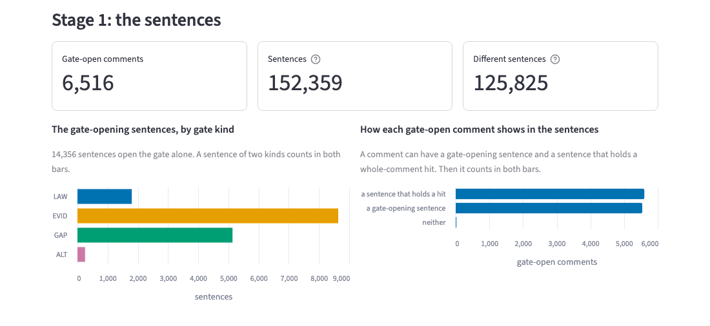

## Stage 2: Vectors

A vector is a list of numbers that a model makes for a sentence. Sentences with the same
meaning get similar vectors. Use two models, so that stage 5 can compare two clusterings.

1. In `.env`, set `EMBED_BASE_URL`, `EMBED_API_KEY` and `EMBED_MODEL` for the first model.
2. Run `make embed VIEW=plain LIMIT=200`.
3. Read the output. It shows the vectors written and the time.
4. Run `make embed VIEW=plain`.
5. Do steps 1 to 4 again for the second model.

If the step stops, run it again. It sends only the sentences that have no vector.

**What our run found.** We used Qwen3-Embedding-8B and BGE-large-en-v1.5 on LM Studio.
Each model has a vector for each of the 125,825 sentences. Qwen also has the comment view.

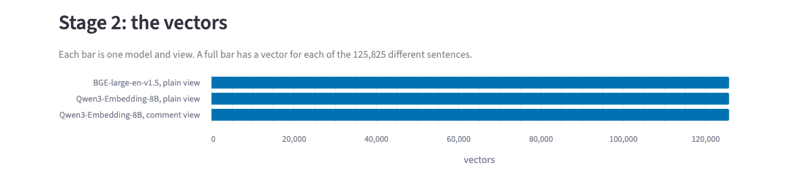

## Stage 3: Cases

A case is one clustering with one set of settings. You cannot know the best settings
before you see the result. Thus you run a set of cases and compare them.

1. Run `make case-set MODEL=<model>` for the first model.
2. Run `make case-set MODEL=<model>` for the second model.
3. Run `make cases`. It lists every case with its figures.

`MODEL` is the model name that `make embed` wrote, for example
`text-embedding-qwen3-embedding-8b@f16`. One case takes from 4 seconds to 3 minutes.

The case set has nine cases. Each case changes one setting of the base case:

| Case | Setting changed | What it tests |
|---|---|---|
| Base | none: gate-opening sentences, UMAP, HDBSCAN 10/10 eom | the starting point |
| Opening and hits | `SENTENCES=opening+hits` | also the sentences that hold a whole-comment hit |
| All sentences | `SENTENCES=all` | every sentence of the gate-open comments |
| By gate kind | `STRUCTURE=by-kind` | one clustering for each gate kind |
| Noise passes | `PASSES=3` | three more clusterings of the sentences in no cluster |
| 21 topics | `K=21` | a fixed number of topics |
| 23 topics | `K=23` | a fixed number of topics |
| PCA | `REDUCTION=pca50 MCS=20 MS=10` | the settings of the first eis-analysis run |
| Small clusters | `MCS=5 MS=1` | smaller clusters |

To test another setting, run `make clusters` with that setting. `docs/clusters.md` lists
the settings. Qwen also accepts an instruction. To test it, run `make embed VIEW=comment`,
then `make case-set MODEL=<model> VIEW=comment`.

**What our run found.** BGE has 11 cases. Qwen has 15: the nine cases of the set, three
cases of the comment view, and three cases with `MERGE=0.95`. Stage 5 tells why we added the
merge cases. In the chart, a good case is low and to the right.

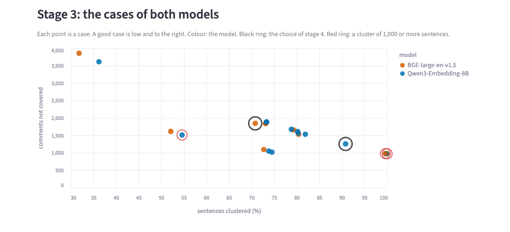

## Stage 4: Best case of each model

Open the tab **Stage 4: Best case of each model**.

1. Select a model.
2. Read the chart. Each point is a case. The number is the case number in the table.
3. Find the cases low and to the right. These cases put many sentences in clusters and
   leave few comments out.
4. Click a point. The case shows under the chart.
5. Open the tab **Read a case**. It shows the case that you clicked.
6. Do the four checks below.
7. Do steps 4 to 6 for the other good cases.
8. Go back to the tab of stage 4. Click the point of the best case.
9. Type a note that tells why the case is best.
10. Click **Choose case N**. A black ring marks the choice on the chart.
11. Do steps 1 to 10 for the other model.

A new choice for a model replaces the old choice.

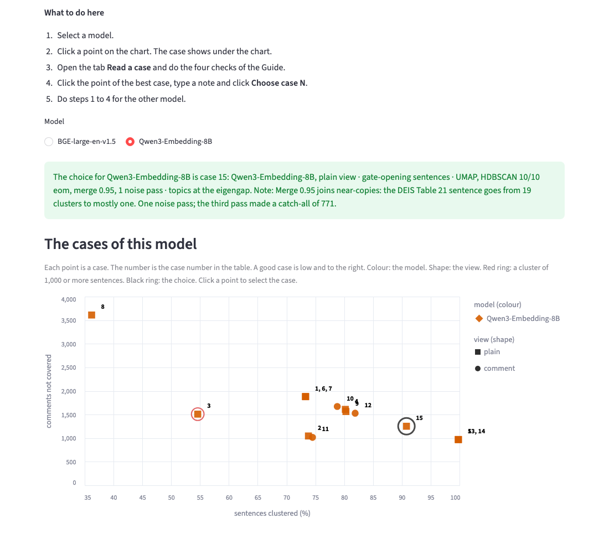

On the chart, a red ring marks a case with a cluster of 1,000 or more sentences. Such a
cluster is usually a catch-all cluster. A black ring marks the choice.

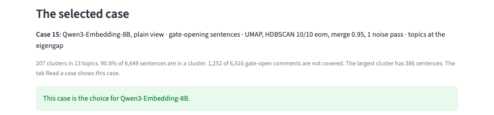

The table gives the figures of each case. "Settings" names what the case changes. "Comments
not covered" is the number of gate-open comments with no substantive sentence in a cluster.

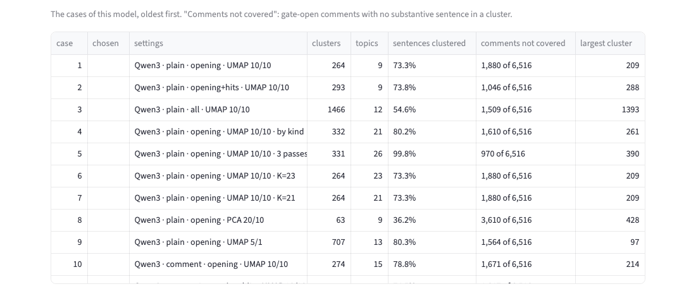

Turn on **Show how alike the cases of this model are** to see the adjusted Rand index of
each pair of cases. A dark cell means that the two cases make the same clusters.

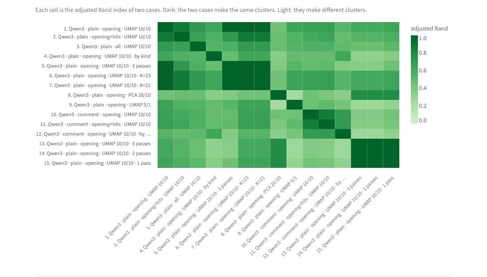

### The four checks

| Check | Where | Good | Bad |
|---|---|---|---|
| 1. One claim in each cluster | Read a case: open a cluster and read its sentences. | You can say the claim in one sentence. | The sentences make two or more claims. |
| 2. No catch-all cluster | Stage 4: the column "largest cluster", and a red ring on the chart. | The largest cluster has a few hundred sentences. | One cluster has thousands of sentences on many subjects. |
| 3. Few comments not covered | Stage 4: the column "comments not covered". | A low number. | Many gate-open comments have no sentence in a cluster. |
| 4. Topics that you can name | Read a case: the list of topics. | The words of each topic name one subject. | The words are general, for example "rule" or "forest". |

Check 1 is the most important. A case can pass check 3 and fail check 1. For example,
noise passes put almost every sentence in a cluster, but some clusters then mix claims.

**What we chose first.** For each model, we chose case 5: the base case with three noise
passes. It covers the most comments: 970 of 6,516 are not covered. The BGE case has one
cluster of 3,076 sentences. That cluster fails check 2. Stage 5 then showed a problem of
both choices, and we chose again. The screenshots show the second choices.

## Read a case

The tab **Read a case** shows one case. It opens the case that you clicked in stage 4. If
you did not click a case, it opens the concern map. To read another case, select it in
the list **Case** at the top of the tab.

The tab has six parts, from top to bottom. Each part has a heading. The last two parts
are under the list of topics. Scroll down past the topics to find them.

| Part | Heading in the tab | What you do there |
|---|---|---|
| 1 | The topics, by gate kind; The cluster sizes; The topic cut | Read the three charts. |
| 2 | The map of the clusters | Point to a cluster to see its words. |
| 3 | Topics | Open a topic to see its clusters. Do check 4 here. |
| 4 | Open a cluster | Select a cluster in the list **Cluster**. Do check 1 here. |
| 5 | The ids of the N comments that hold these sentences | Open it to copy the comment ids. |
| 6 | Sentences in no cluster | Open it to read the sentences that the case left out. |

### Part 1: the three charts

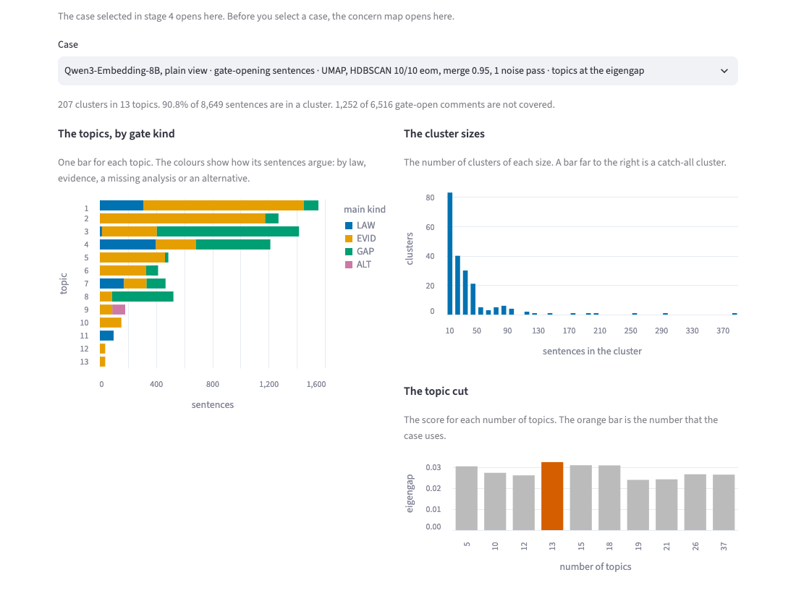

- **The topics, by gate kind**: one bar for each topic. The colours show how its sentences
  argue: by law, evidence, a missing analysis or an alternative.
- **The cluster sizes**: the number of clusters of each size. A bar far to the right is a
  catch-all cluster.
- **The topic cut**: the score for each number of topics. The orange bar is the number
  that the case uses.

### Part 2: the map of the clusters

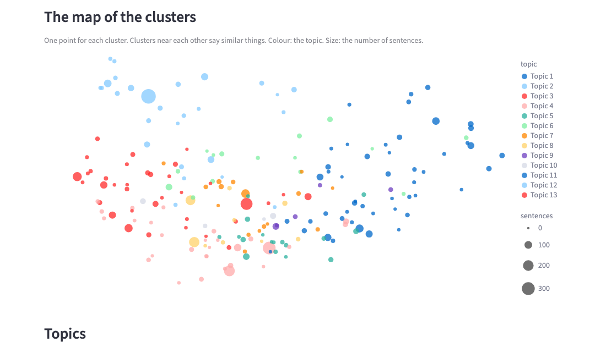

Each point is one cluster. Clusters near each other say similar things.

### Part 3: the topics

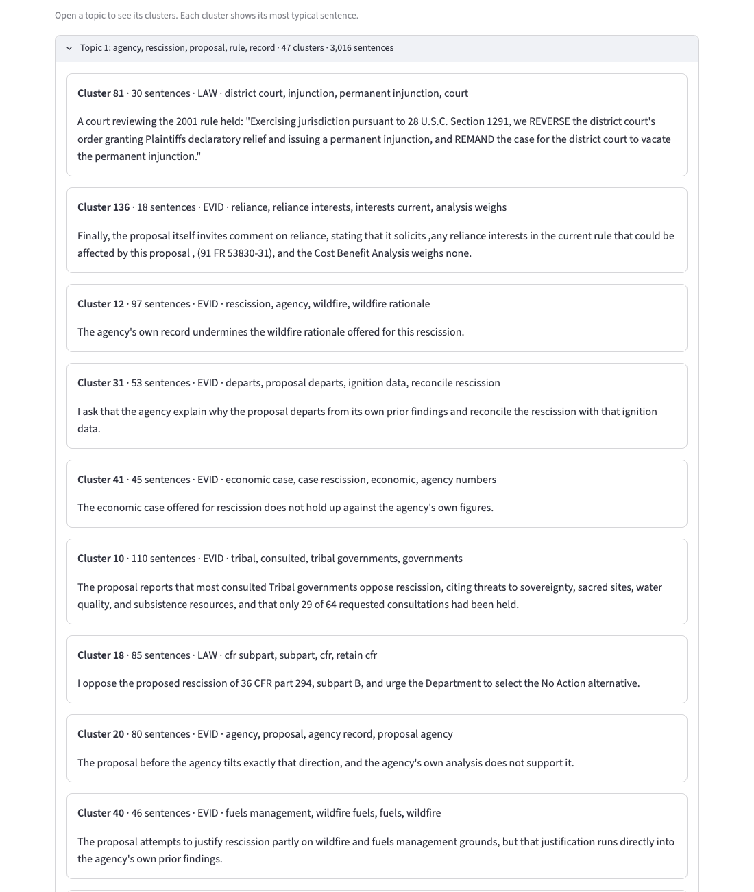

1. Click a topic to open it.
2. Read the words of the topic and the typical sentence of each cluster.
3. Do check 4: the words of the topic name one subject.

### Part 4: one cluster, with its sentences and comments

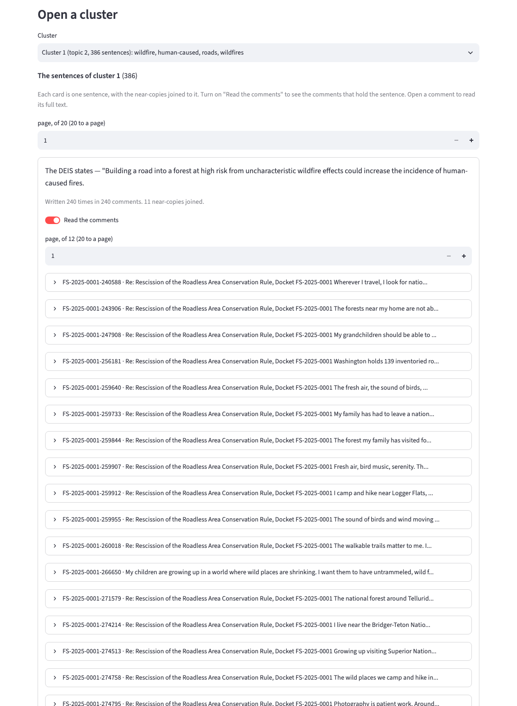

1. Scroll down past the topics to the heading **Open a cluster**.
2. In the list **Cluster**, select a cluster. The list gives its number, topic, size and words.
3. Read the sentences. Each card is one sentence.
4. If a cluster has more than 20 sentences, use the **page** box to see the next 20.
5. To see the comments that hold a sentence, turn on **Read the comments** under it.
6. Click a comment to read all of it.
7. Do check 1: you can say the claim of the cluster in one sentence.

### Parts 5 and 6

- **The ids of the N comments that hold these sentences**: the comment ids of the selected
  cluster. Paste an id into the page Comment to read the comment with its readings.
- **Sentences in no cluster**: the sentences that the case left out. If many of them make
  one claim, the case missed that claim.

## Stage 5: Concern map

Open the tab **Stage 5: Concern map**. The two choices group the same sentences. The tab
shows where they group them differently.

1. In the table, click a row near the top. The top rows are where the two choices differ
   most.
2. Read the two clusters under the table: the cluster of the first choice on the left, the
   matching cluster of the second choice on the right.
3. Note which side makes one claim.
4. Do steps 1 to 3 for three or four rows.
5. Under the choice that made one claim more often, type a note and click **Use this case
   as the concern map**.

A new decision replaces the old decision.

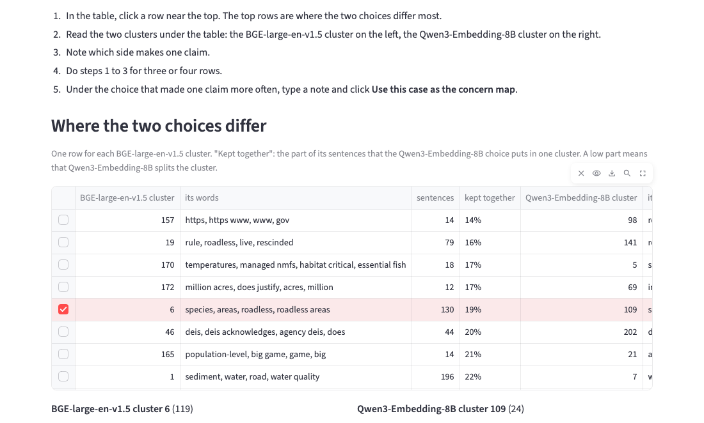

Each row of the table is a cluster of the first choice. "Kept together" is the part of
its sentences that the second choice puts in one cluster. A low part means that the second
choice splits the cluster.

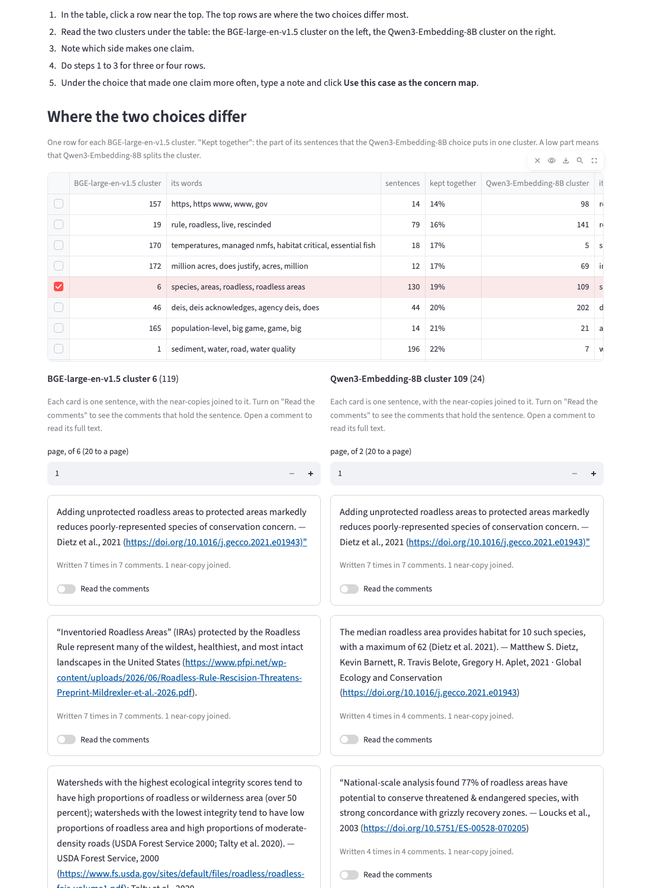

Open **How far the two choices agree overall** to see three numbers and a chart:

- **Clustered by both**: the sentences that both choices put in a cluster. The other two
  numbers use these sentences only.
- **Adjusted Rand**: how alike the two choices cluster these sentences. 1 means the same
  clusters. Near 0 means different clusters.
- **Clusters kept together**: the clusters of the first choice that keep 80% or more of
  their sentences in one cluster of the second choice.

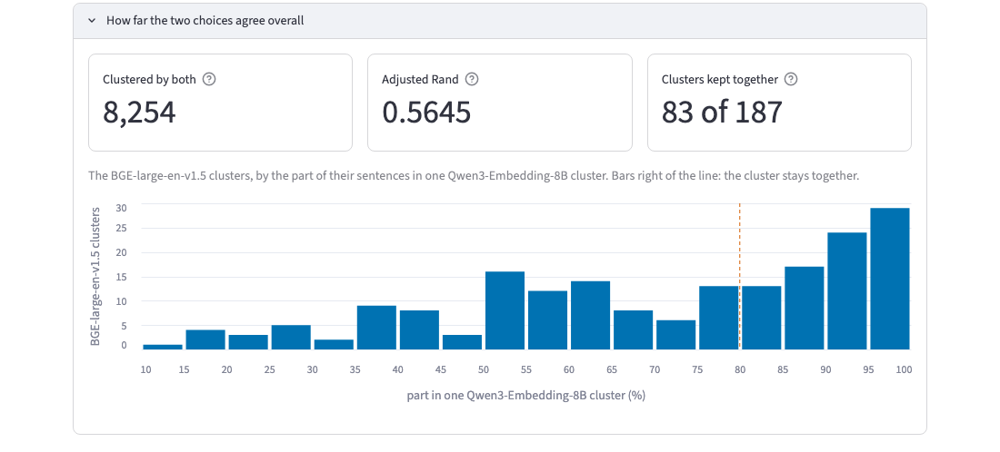

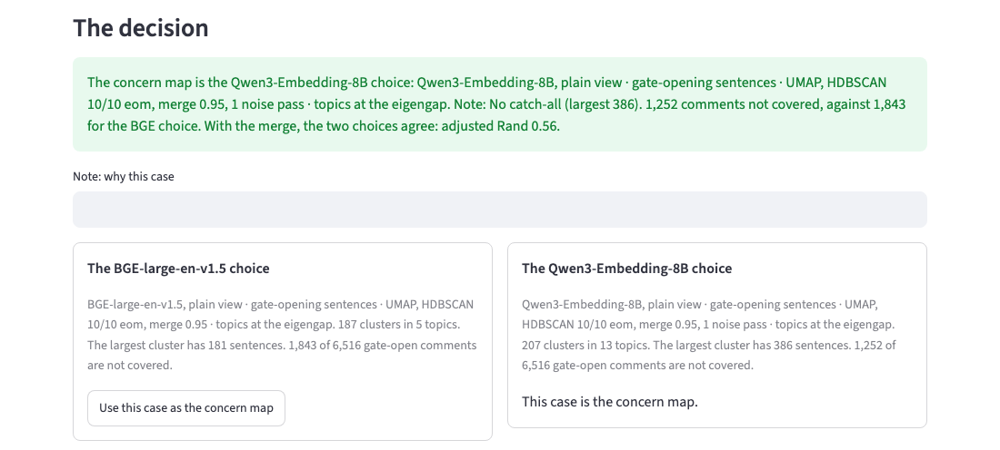

**What we found, first try.** The first two choices were very different: the adjusted
Rand was 0.0527. The top row was the BGE catch-all cluster of 3,076 sentences. We decided
on the Qwen choice.

The side-by-side clusters then showed a problem of both choices. A campaign letter has a
sentence on DEIS Table 21, and commenters changed some of its words. The Qwen choice put
the copies of that sentence in 19 clusters. Thus one claim was 19 clusters, and the next
step would write 19 concern statements for it.

**What we did, second try.** `MERGE=0.95` joins near-copies of a sentence before the
clustering. We ran these cases:

| Case | Largest cluster | Comments not covered | Result |
|---|---|---|---|
| Qwen, merge, 3 noise passes | 771 | 971 | The third pass made a catch-all. |
| Qwen, merge, 1 noise pass | 386 | 1,252 | No catch-all. The Table 21 sentence is in 7 clusters, 264 of its copies in one. |
| BGE, merge, 1 noise pass | 2,664 | 975 | A catch-all. |
| BGE, merge, no noise pass | 181 | 1,843 | No catch-all. |

To run one of these cases, use `make clusters`, for example:

```
make clusters MODEL=<model> VIEW=plain MERGE=0.95 PASSES=1
```

The noise passes are numbered from the first clustering. Thus `PASSES=2` gives the same
case as `PASSES=3` if the last pass finds no cluster.

We chose the two cases with no catch-all. With the merge, the two choices agree much more:
the adjusted Rand is 0.5645, and 83 of the 187 BGE clusters are kept together. The concern
map is the Qwen choice. It covers 591 more comments than the BGE choice.

## What the concern map holds

The tab **What the stages found** shows the concern map at the bottom.

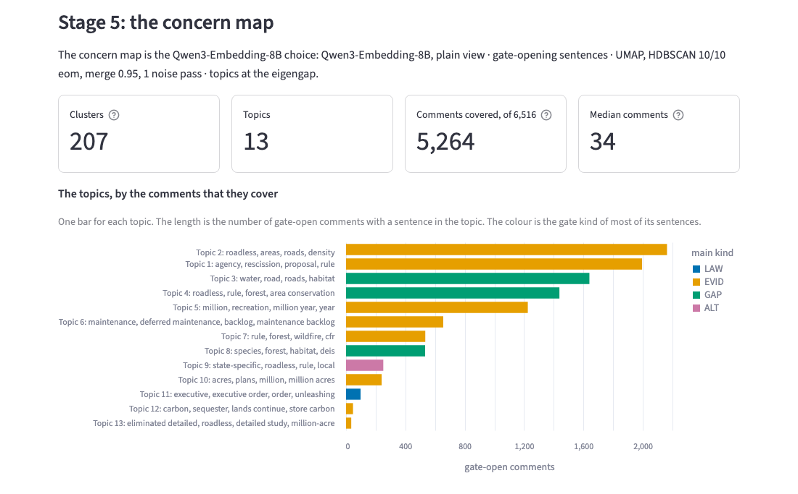

- **Clusters**: the next step writes one concern statement for each cluster.
- **Comments covered**: the gate-open comments with a substantive sentence in a cluster.
- **The topics, by the comments that they cover**: one bar for each topic. The colour is
  the gate kind of most of its sentences.

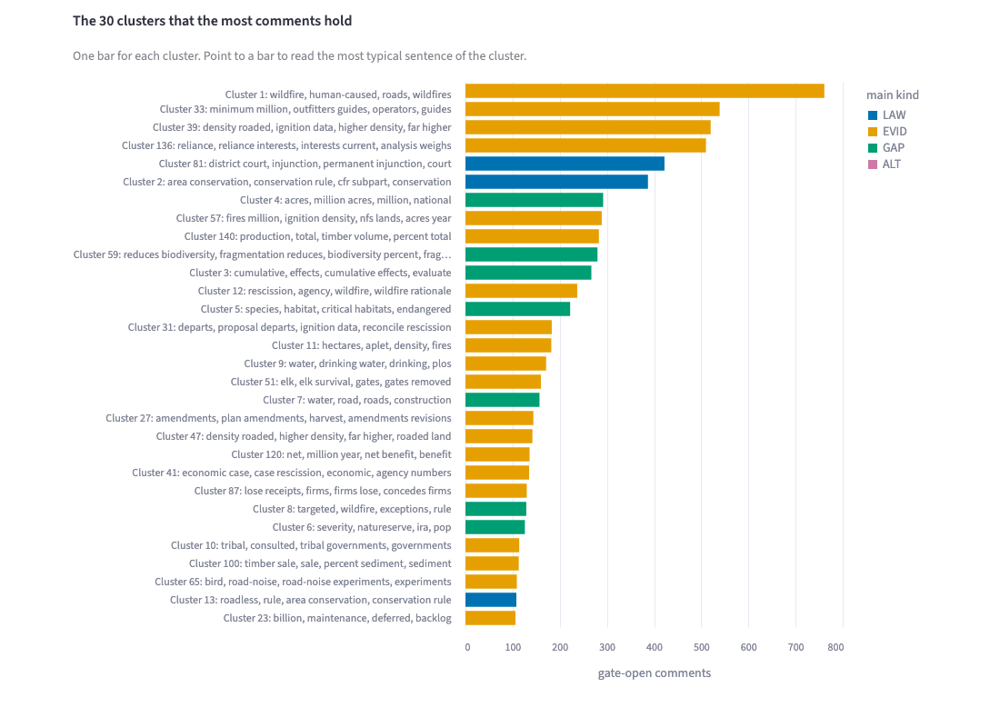

- **The 30 clusters that the most comments hold**: point to a bar to read the most typical
  sentence of the cluster.

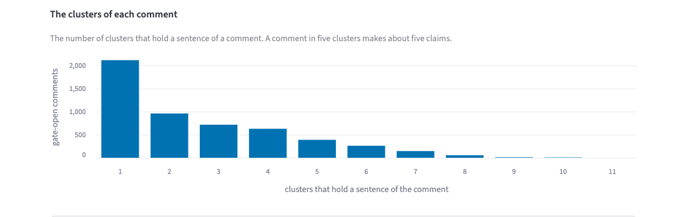

- **The clusters of each comment**: a comment with sentences in five clusters makes about
  five claims.

**What our concern map holds.** 207 clusters in 13 topics. 5,264 of the 6,516 gate-open
comments have a sentence in a cluster. 2,112 comments are in one cluster only. Topic 2,
on roads and fire, covers the most comments: 2,163.

Some topics hold clusters on different subjects. For example, topic 1 holds a court
ruling, tribal consultation and the economic case. The topics only group the clusters. The
next step reads the clusters, not the topics.

## After stage 5

The next step of the method writes one concern statement for each cluster of the concern
map. That step is not built yet. It sends text to a model, so it needs the model server of
`.env`.

## Do a stage again

| Stage | Command | What it replaces |
|---|---|---|
| 1. Sentences | `make sentences` | The sentence tables. Run stages 2 to 5 again after it. |
| 2. Vectors | `make embed VIEW=plain` | Nothing. It adds the vectors that are missing. |
| 3. Cases | `make clusters <settings>` | The rows of the case with the same settings. Other cases stay. |
| 4. Choice | Click **Choose case N**, or run `make choose`. | The choice of that model. |
| 5. Concern map | Click **Use this case as the concern map**, or run `make concern-map`. | The concern map. |

## The terminal commands

| Command | What it does |
|---|---|
| `make cases` | Lists every case with its numbers. |
| `make choose CASE=<case> NOTE="..."` | Records a choice of stage 4, as the button does. |
| `make concern-map CASE=<case> NOTE="..."` | Records the concern map of stage 5, as the button does. |
| `make compare-cases A=<case> B=<case>` | Compares two cases, cluster by cluster. |

## Glossary

| Term | Meaning |
|---|---|
| Adjusted Rand index | How alike two cases cluster the same sentences. 1 means the same clusters. Near 0 means different clusters. |
| BGE-large-en-v1.5 | An embedding model with 335 million parameters. It reads English only. |
| Case | One clustering with one set of settings. |
| Catch-all cluster | A very large cluster with sentences on many subjects. |
| Choice | The best case of one model, recorded in stage 4. |
| Cluster | A group of sentences that are close together. In a good case, a cluster is one claim. |
| Comment view | Each sentence goes to the model with an instruction: find the agency text that answers the claim. Only Qwen accepts an instruction. |
| Comments not covered | Gate-open comments with no substantive sentence in a cluster. |
| Concern map | The case that you decide on in stage 5. It is one of the two choices. |
| eom, leaf | Two ways for HDBSCAN to select clusters. eom keeps the clusters that last longest. leaf keeps the smallest clusters. |
| Gate | The test that tells if a comment is substantive. |
| Gate kind | How a sentence argues: LAW (a law), EVID (evidence), GAP (a missing analysis) or ALT (an alternative). |
| Gate-opening sentence | A sentence that opens the gate alone. |
| HDBSCAN | The clustering method. It finds groups of sentences that are close together. It needs no number of clusters. |
| Leader | A sentence that stands for its near-copies when a case merges them. |
| MCS, MS | Two HDBSCAN settings. MCS is the smallest cluster size. MS sets how close the sentences of a cluster must be. |
| Merge | A setting that joins near-copies of a sentence before the clustering. `MERGE=0` joins none. |
| Noise | The sentences that a case puts in no cluster. |
| Noise pass | One more clustering of the noise. It puts more sentences in clusters, but it can make catch-all clusters. |
| PCA, UMAP | Two methods that make the vectors shorter before HDBSCAN. |
| Plain view | Each sentence goes to the model with no instruction. |
| Qwen3-Embedding-8B | An embedding model with 8 billion parameters. It reads more than 100 languages and accepts an instruction. |
| Sentences clustered | The part of the sentences of a case that is in a cluster. |
| Substantive sentence | A sentence that opens the gate alone, or holds a whole-comment gate hit. |
| Terms | The words that are frequent in one cluster or topic and rare in the others. |
| Topic | A group of clusters on one subject. |
| Vector | A list of numbers that a model makes for a sentence. |
| Whole-comment hit | A rule hit that opened the gate when the rules read the whole comment. |
